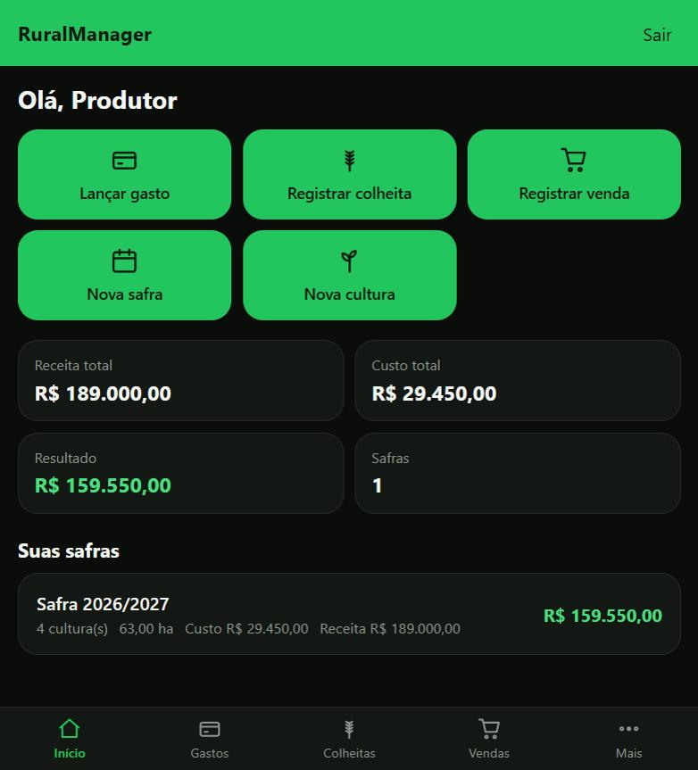
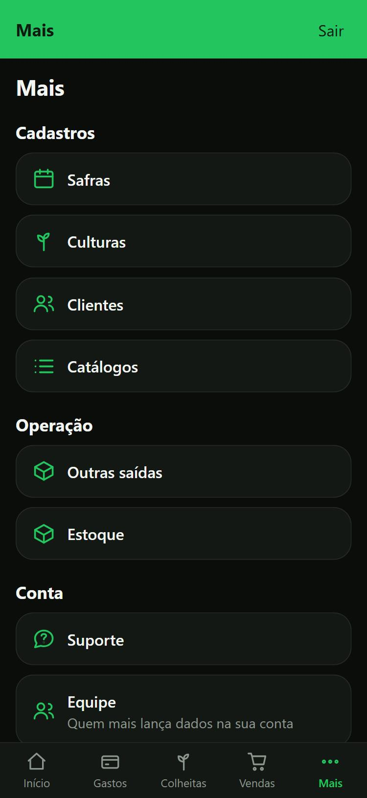

# RuralManager

Gestão agrícola para pequenos e médios produtores: safras, culturas, colheitas, gastos, vendas, estoque e relatórios de lucro, custo por hectare e produtividade. Site responsivo, instalável como PWA, pensado para uso no celular no meio da lavoura ou no computador do escritório.



## Sumário

- [Sobre o projeto](#sobre-o-projeto)
- [Funcionalidades](#funcionalidades)
- [Tecnologias](#tecnologias)
- [Capturas de tela](#capturas-de-tela)
- [Como rodar localmente](#como-rodar-localmente)
- [Variáveis de ambiente](#variáveis-de-ambiente)
- [Deploy](#deploy)
- [Segurança](#segurança)
- [Status do projeto](#status-do-projeto)

## Sobre o projeto

Começou como o trabalho final de Programação Orientada a Objetos I no IFC Campus Rio do Sul, em Java puro com DAO e MySQL (essa versão fica arquivada, só para referência). Depois foi reescrito do zero como produto completo: API em Spring Boot, frontend em React, banco Postgres, autenticação própria, pensado desde o início para uso real por produtores rurais, não só como exercício acadêmico.

## Funcionalidades

- Cadastro de Safra, Cultura, Colheita, Gasto, Venda e Cliente, com atalho de criação rápida ("+ Novo(a)") direto de dentro de qualquer formulário que dependa de um cadastro ainda inexistente.
- Painel com receita, custo, resultado e área plantada por safra.
- Controle de estoque por colheita: colhido, vendido, destinado a outros fins e saldo disponível.
- Equipe: o produtor convida operadores (cônjuge, filho, contador) para lançar dados na mesma conta, sem acesso a configurações nem à gestão da equipe.
- Recuperação de senha por e-mail, com código de 6 dígitos (via Resend).
- Canal de suporte: o usuário relata problemas e um painel de administrador acompanha e resolve.
- Catálogos compartilhados entre produtores (produtos, unidades de medida, categorias de gasto, destinos), mantidos por um administrador.
- Instalável como PWA: ícone na tela inicial, abre em tela cheia.

## Tecnologias

**Backend:** Java 21, Spring Boot 3, Spring Security (JWT stateless), Spring Data JPA/Hibernate, Flyway, PostgreSQL (Supabase).

**Frontend:** React 18, TypeScript, Vite, TanStack Query, vite-plugin-pwa.

**Infraestrutura:** Docker, nginx, Render.com.

## Capturas de tela

| Painel (desktop) | Menu organizado (mobile) |
| --- | --- |
|  |  |

## Como rodar localmente

Requisitos: JDK 21, Maven 3.9+, Node 20+.

```bash
cp .env.example .env        # preencha RM_DB_URL, RM_DB_PASSWORD, RM_JWT_SECRET
set -a; source .env; set +a
mvn spring-boot:run          # API em :8080
cd frontend && npm install && npm run dev   # app em :5173
```

Testes: `mvn test` (API) e `cd frontend && npm test`.

## Variáveis de ambiente

| Variável | Descrição |
|---|---|
| RM_DB_URL | JDBC do Postgres/Supabase (`sslmode=require`) |
| RM_DB_USER / RM_DB_PASSWORD | credenciais do banco |
| RM_JWT_SECRET | segredo HS256, 32+ caracteres |
| RM_JWT_MINUTOS | validade do token (padrão 480) |
| RM_CORS_ORIGENS | origens do front, separadas por vírgula |
| RM_OPENAPI | `true` liga o Swagger em `/swagger-ui.html` (recurso de API docs; `/v3/api-docs` e `/swagger-ui/**` exigem login) |
| RM_RESEND_API_KEY | chave da API do [Resend](https://resend.com) para o e-mail de recuperação de senha; em branco, só registra no log |
| RM_EMAIL_REMETENTE | remetente dos e-mails, ex. `RuralManager <onboarding@resend.dev>` |
| RM_ADMIN_EMAIL / RM_ADMIN_SENHA | cria o administrador inicial na subida (senha com 12+ caracteres); em branco, nenhum é criado |

## Deploy

**Local / VPS único:** `docker compose up --build` sobe a API e o front (nginx, porta 8081, com proxy `/api`).

**Render.com (hospedagem gratuita, sem domínio próprio):** o repositório já tem um `render.yaml` pronto.

1. Crie uma conta grátis em [render.com](https://render.com).
2. **New > Blueprint**, conecte este repositório no GitHub. O Render lê o `render.yaml` e propõe dois serviços: `ruralmanager-api` e `ruralmanager-web`.
3. Preencha os campos secretos que ele pedir (os mesmos valores do seu `.env` local: `RM_DB_URL`, `RM_DB_PASSWORD`, `RM_JWT_SECRET`, `RM_RESEND_API_KEY`, `RM_ADMIN_EMAIL`, `RM_ADMIN_SENHA`).
4. Aguarde o build dos dois serviços e abra a URL do serviço `ruralmanager-web` (o Render mostra no painel; se os nomes `ruralmanager-api`/`ruralmanager-web` já estiverem em uso, ele acrescenta um sufixo, ex. `ruralmanager-web-w8cf.onrender.com`; nesse caso ajuste `RM_CORS_ORIGENS` e `VITE_API_URL` no `render.yaml` para os nomes finais).

No plano gratuito, cada serviço "dorme" depois de 15 min sem acesso e demora alguns segundos para acordar na próxima visita. O deploy acontece automaticamente a cada push na branch `main`.

Em qualquer outra hospedagem separada (front e API em domínios diferentes), builde o front com `VITE_API_URL=https://sua-api` e ajuste `RM_CORS_ORIGENS` na API para a URL do front. A API é stateless: escala horizontalmente atrás de um balanceador.

## Segurança

JWT stateless, BCrypt(12), CPF/CNPJ validados por dígito verificador, isolamento completo entre produtores (toda consulta já sai filtrada pelo dono; acessar um registro de outro produtor devolve 404, nunca um dado alheio), travas de linha no estoque para evitar venda duplicada em corrida, limitador de tentativas de login e de código de recuperação de senha, erros devolvidos em formato padrão (ProblemDetail) sem vazar detalhe interno.

Testado ativamente contra isolamento entre contas, token forjado ou adulterado, escalada de privilégio entre papéis (Operador/Produtor/Admin), força bruta de login e injeção SQL/XSS: nenhum desses ataques teve sucesso. Detalhes e metodologia na [release mais recente](../../releases/latest).

## Status do projeto

Backend e frontend verificados de ponta a ponta (compilação, testes, Supabase real, navegador): cadastro, safra, cultura, colheita, gasto, venda, painel, suporte (relatar problemas), recuperação de senha por e-mail e painel de administrador. Em uso real desde novembro de 2026.
